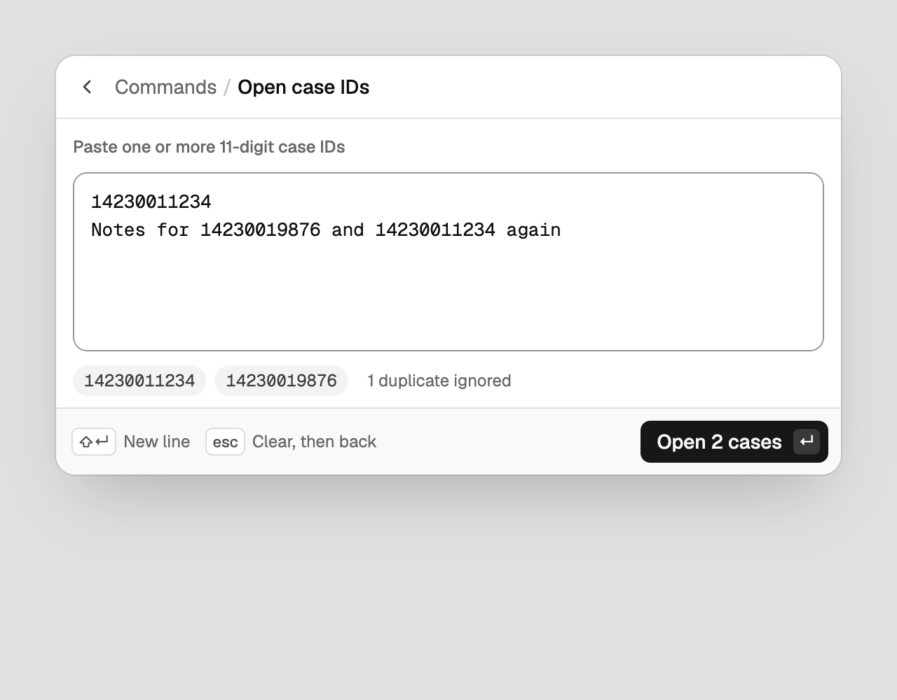
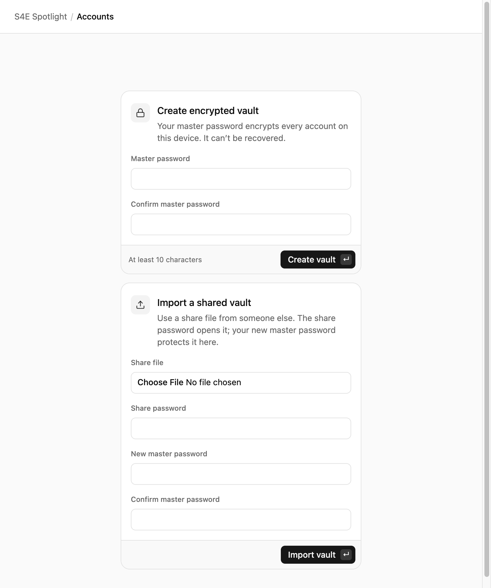

<p align="center">
  
</p>

# S4E Spotlight

S4E Spotlight adds a command palette to ordinary webpages. A command palette is a search box that runs actions. On macOS, press `Command+/`. On Windows or Linux, press `Ctrl+/`.

A store is a Seller Central storefront. You can open cases, shipments, and SKUs from the palette. You can generate reports and open Time Out. You can switch stores.

A vault is the encrypted record of saved logins. The vault stays in this Chrome profile.

<p align="center">
  
</p>

## Install

This project uses Node 24.

Load the extension with these steps:

1. Clone this repository.
2. Run `npm install`.
3. Run `npm run build`.
4. Open `chrome://extensions`.
5. Turn on Developer mode.
6. Choose Load unpacked.
7. Select the `dist/` directory.
8. Open a normal http or https page.
9. If you use macOS, press `Command+/`.
10. If you use Windows or Linux, press `Ctrl+/`.

The shortcut does nothing on a `chrome://` page or on the Chrome Web Store. The shortcut does nothing on an XML document or an SVG document. The shortcut does nothing while the address bar has focus.

## Open case IDs

A case ID is an 11-digit support number. A background tab opens behind your current page. Paste text that contains one or more case IDs. The extension opens each new ID in a background tab.

```
14230011234
Notes for 14230019876 and 14230011234 again
```

If the text contains 11 to 50 IDs, you must choose Confirm bulk open. If the text contains more than 50 IDs, the extension opens nothing. The extension keeps the first copy of a repeated ID.

<p align="center">
  
</p>

## Scrape case

Choose Scrape case. The S4E Spotlight window opens on the Cases tab. Paste one or more case IDs there.

The window shows the reply count and the opening date for each case. The window marks a case that failed. The extension writes the JSON file only after you choose Download JSON.

## Open shipment IDs

FBA is Amazon warehouse fulfillment. A shipment ID is FBA plus nine characters. Paste text that contains one or more shipment IDs.

```
https://sellercentral.amazon.com/fba/inbound-shipment/summary/FBA15ABCD123/contents
```

The extension reads the shipment ID from a link. The extension changes letters in the ID to uppercase. The extension drops a repeated ID. The extension opens each ID in a background tab.

## Search SKUs

A SKU is the seller product code. Paste one or more SKUs. Put each SKU on its own line. You can also separate SKUs with a comma or a tab.

```
BLUE-MUG-01, RED-MUG-02
GREEN-MUG-03
```

The extension ignores a value longer than 40 characters. Each remaining SKU opens an inventory search in a background tab.

## Bulk removal

Paste up to 50 SKUs for removal. The extension opens the Create removal order page in one background tab. The summary names each skipped SKU and the reason.

```
BLUE-MUG-01
RED-MUG-02
```

Choose Go to removal to open that tab. The extension does not submit the order.

## Open Time Out

Choose Open Time Out. The extension opens the Time Out Google Sheet in a background tab. The extension opens the Time Out Google Form as the active tab.

The Date field uses the local calendar date. Settings is the small window under the toolbar icon. Choose Edit form values in Settings to change the filled fields.

## Generate reports

Choose Generate reports. The S4E Spotlight window opens on the Reports tab. Five boxes are on: Unfulfillable, Seller Feedback, Stranded, Suppressed, and Shipping Queue.

<p align="center">
  
</p>

The extension loads nothing until you choose Generate report. The report needs a Seller Central tab that is signed in. If that tab is missing, the extension opens Seller Central.

Choose Download to write the Sheets file. The Sheets file name is `{Current Store} - {dd-mmm-yyyy} - Sheets.xlsx`. The name uses the last store you switched to, or Unknown. The debug button writes the raw workbook. The raw file name is `{Current Store} - {dd-mmm-yyyy}.xlsx`.

Column rules and partial-load notes are in [docs/spec.md](docs/spec.md).

## Switch store

Choose Switch store. The palette shows a search list of your stores. Current is the store from the last finished switch. Before any switch finishes, Current is Unknown.

Choose Current to focus an open Seller Central tab. If no Seller Central tab is open, the extension opens Seller Central. Choose a different store to switch to it.

A helper window stays behind your work. The switch runs in a helper window. A credential is the saved login. The same credential skips sign-in.

If the vault is locked, unlock it on the Accounts page. You type the master password on the Accounts page. The website does not receive the master password.

The master password has at least 10 characters. The extension does not store the master password. There is no way to recover the master password.

Type RESET to use Reset vault. Reset vault deletes the encrypted data.

<p align="center">
  
</p>

## Settings

The toolbar icon opens Settings. You can turn each command on or off. Choose Edit form values to change the Time Out form. Choose Manage accounts to open the Accounts page.

Choose Download logs to write the log as JSON. Choose Clear to delete the log. Logs stay on this device.

## Keyboard

Use these keys in the palette:

- The arrow keys move the highlight.
- Enter runs the highlighted command.
- Shift+Enter inserts a new line in a text field.
- If a field has text, Escape clears that text.
- If the field is empty, Escape goes back one screen.
- If you are on the command list, Escape closes the palette.
- The shortcut closes the palette at once.
- A click on the dimmed page closes the palette at once.

Colors follow the light or dark theme of your system. If your system asks for reduced motion, the palette does not animate.

<details>
<summary>Security</summary>

The vault uses AES-256-GCM. The master password uses PBKDF2-HMAC-SHA256. That function runs 600,000 iterations.

A share file uses the same two protections. The share file has its own password. That password is not the master password. The extension does not store the share password. There is no recovery for the share password.

An import must use 600,000 iterations. If a file used fewer iterations, its owner must export it again. The recipient must enter the share password before the extension can decrypt the file. Give the share password apart from the file. After import, the vault uses the master password of the recipient.

Do not put passwords in source files. A commit keeps them.

Lock clears the session key in memory. The vault also locks when you restart the browser, reload the extension, update the extension, or turn the extension off.

When you choose a locked store, Unlock accounts opens the Accounts tab. You type the master password on that extension page. After the unlock succeeds, the store switch continues. That window closes after the unlock.

The return request works once. The return request expires after 15 minutes. The return request belongs to the original page and to that window.

Generate reports, Scrape case, and unlock use one S4E Spotlight window. That window has Reports, Cases, and Accounts tabs. The extension reuses the same window each time. The window opens over the window you started from.

Progress, customer data, workbooks, case files, and the master password stay in that window. Scrape case opens the Cases tab. The Accounts tab can switch stores and can follow a switch that is still running.

A prepared run permits one report or case job. Report and case requests need a prepared run. That run belongs to the same window document and to one Seller Central tab. The extension drops that permission when the page changes or the page closes. It also drops that permission when the store switches, you cancel, the run finishes, or the run expires.

Plaintext is text that is not encrypted. Lock stops unfinished vault work. Lock clears plaintext account editors on open Accounts pages.

A wrong password causes a delay. The delay has a limit. A wrong password does not erase the vault.

Only the Accounts page can create, read, change, share, or reset the vault. The S4E Spotlight window can also unlock and lock the vault. The public store index is the list of store names. A feature flag records whether a command is on.

A normal webpage receives the public store index and the feature flags. A normal webpage does not receive Time Out form values. A normal webpage does not receive the full vault.

The manifest asks for the storage permission for the vault. A trusted click is a click Chrome accepts as yours. The manifest asks for the debugger permission so the extension can send a trusted click. That click happens only during a store switch you requested. The manifest asks for the scripting permission so the passkey block runs only during a switch.

Chrome warns that debugger access can read and change website data. The debugger attaches only to the dedicated login tab. The debugger attaches only while that tab is visible.

The debugger detaches after each trusted click. There is no analytics service. There is no external credential service.

A passkey is a login that uses the device. While an account switch runs, the extension blocks passkey prompts on Seller Central. The block runs in the main JavaScript world of the page, before the login scripts. Outside a switch, passkeys work as usual.

Automated sign-in accepts only the exact HTTPS Seller Central origin. Automated sign-in accepts only the top frame. Automated sign-in accepts only a live login document. If another extension blocks a trusted click, that other extension stays as it is. You then see an explanation.

Account data stays in this Chrome profile. If you uninstall the extension, Chrome removes that data. The share file leaves the device only when you export it.

An OTP is a one-time passcode. The extension removes password, share-password, OTP, and related secret fields before it prints a log. It removes those fields before it forwards a log. It removes those fields before it stores a log.

Git ignores installed packages and local debug logs. CI runs a clean install with lifecycle scripts off, a dependency audit, `npm run typecheck`, tests, and a production build.

</details>

<details>
<summary>Logs</summary>

A content script is extension code on a page. Every part of the extension writes a log entry. The parts are the background worker, the content script on the Seller Central tab, the palette, account automation, and the extension pages.

Each entry has a time, a level, a context, and an event name. An entry can also have a duration and a run ID. Entries from one report or one store switch share that run ID.

A service worker is the extension background process. Console lines start with `[S4E]`. You can filter the page console by `[S4E]`. The page console includes the palette and the Seller Central content script.

Open `chrome://extensions`. Choose Inspect views for the service worker. You can filter that console by `[S4E]`.

The background worker keeps the newest 1,000 entries in `chrome.storage.local`. Only an extension page can read the log.

Each report source writes a `report.fetch` entry. That entry has the item count.

`bodyMs` is the download and parse time. `parallelism` is total request time divided by wall time. The total includes body time. A value near 1 means the requests ran one after another.

For each Seller Central endpoint, the entry also has these values:

- The request count.
- The failure count.
- The status codes.
- The average time to the response headers.
- The slowest time to the response headers.
- The average body time.
- The wall time.
- The maximum number of requests in flight.
- The `parallelism` value.

Bulk removal writes a `removal.bulk` entry. That entry counts SKUs requested, opened, and skipped.

Bulk removal also writes a `removal.resolve` entry. That entry lists the Seller Central requests. It records whether the Amazon multi-SKU lookup found the SKUs. It records whether a scan of the unfulfillable list found them. The field name for that result is `bulkRemoval.resolve`.

Feedback writes a `feedback.load` entry. That entry says whether the read used parallel chains, one chain, or one page. It also counts the requests.

The shipping-queue list records the slices and the requests. `lastInWindowAt` marks the last in-window shipment. `maxGap` is the longest stretch of older shipments. An in-window shipment can follow that stretch.

Shipment details record the extra SKU-line requests. `linesCut` names a shipment with short SKU lines.

A request that is no longer needed is `aborted`. An aborted request is not a failure.

The palette writes a `report.run` summary. The summary lists the chosen sections, the time for each source, and the slowest source.

The extension writes a warning in these cases:

- A request takes 5 seconds or more.
- A request fails.
- The shipping queue pauses for a session.
- The extension tries a schema read again.
- Feedback falls back to one chain.
- A load is only partial.

A log can hold these values:

- Counts.
- Durations.
- Status codes.
- Endpoint paths with the IDs collapsed.
- Store names.
- Error messages.
- The content type of a page when the palette fails to load.
- The shipment IDs of the first few shipments whose details failed.
- The path and title of a login page that account automation does not recognize.

A log never holds a password. A log never holds a verification code. A log never holds the master password. A log never holds customer data such as feedback text. A log never leaves the device.

</details>

<details>
<summary>Where the shortcut cannot run</summary>

The Manifest V3 command API cannot use `/` as a command key. A content script captures the shortcut instead. The shortcut works only while an eligible webpage has focus.

Chrome does not run a content script on a `chrome://` page. Chrome does not run a content script on the Chrome Web Store. The shortcut cannot run while the address bar has focus. The shortcut cannot run while another browser control has focus.

The palette needs an HTML page. The shortcut does nothing on an XML or SVG document, such as a feed, a sitemap, or an SVG file.

</details>

## Develop

`npm run dev` writes the extension into `dist/` as you edit. After a rebuild, select Reload on the extension card. Then reload the page you are testing.

Run `npm run typecheck` for the types. Run `npm test` for the tests. Run `npm run build` for the production files. If you add a UI component, run `npx shadcn@4.22.1 add <component>`. That command is not part of the extension.
