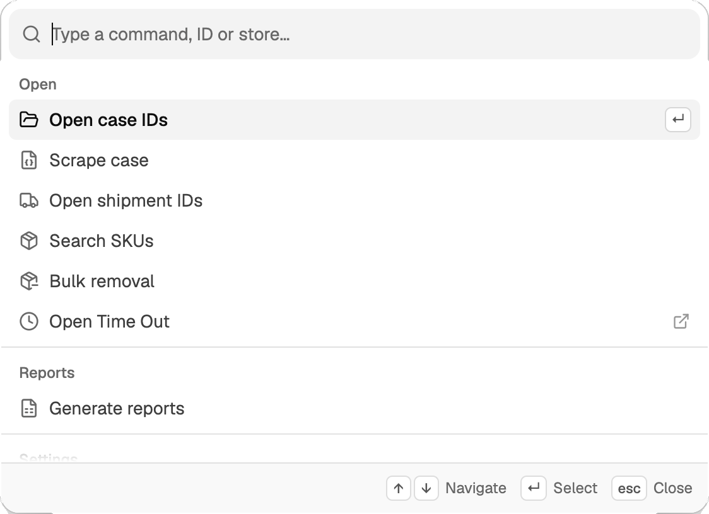
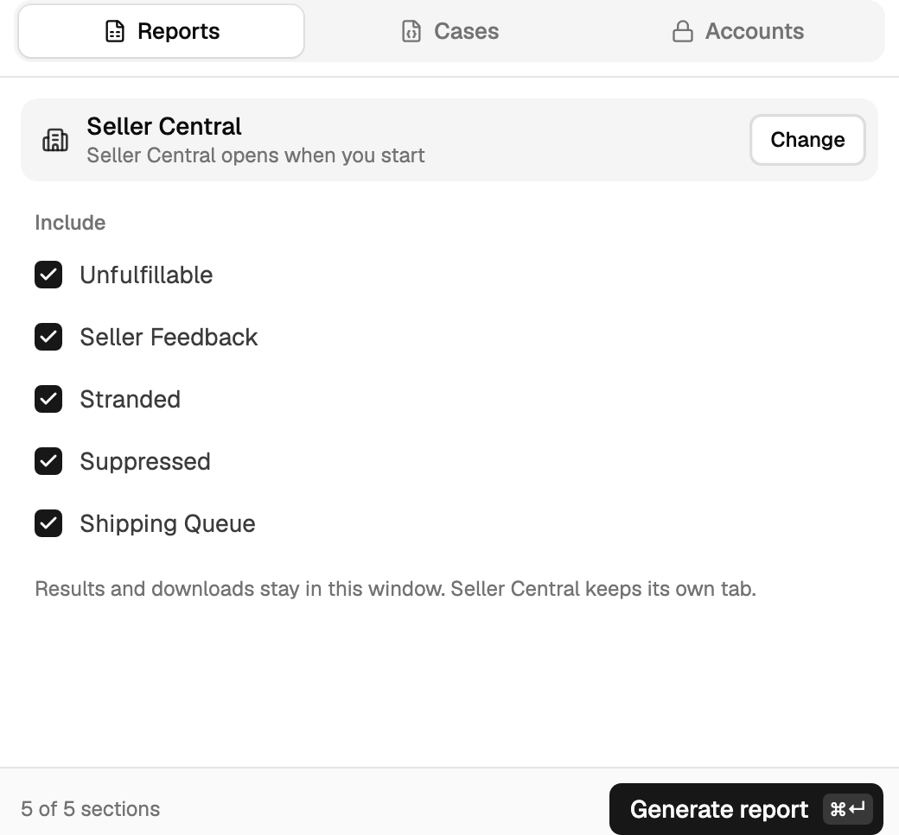

<p align="center">
  
</p>

# S4E Spotlight

A Chrome extension that puts a command palette on any webpage, built for Seller Central support work. Press `Command+/` (macOS) or `Ctrl+/` (Windows and Linux), pick a command, and paste your text. Case IDs, shipment IDs, and SKUs turn into background tabs. Reports build in one window. Store switches run on their own.

<p align="center">
  
</p>

## What it does

| Command | Result |
| --- | --- |
| [Open case IDs](#open-case-ids) | Opens each case in a background tab. |
| [Scrape case](#scrape-case) | Collects reply counts and opening dates into a JSON file. |
| [Open shipment IDs](#open-shipment-ids) | Opens each FBA shipment in a background tab. |
| [Search SKUs](#search-skus) | Opens an inventory search for each SKU. |
| [Bulk removal](#bulk-removal) | Prefills a Create removal order page with up to 50 SKUs. |
| [Open Time Out](#open-time-out) | Opens the Time Out sheet and form. |
| [Generate reports](#generate-reports) | Builds five Seller Central reports into an Excel file. |
| [Switch store](#switch-store) | Signs in to another store from your encrypted vault. |

New tabs open in the background, so you keep your place. Your saved logins stay in your Chrome profile, and nothing runs unless you start it.

## Install

You need Node 24.

1. Clone this repository.
2. Run `npm install`, then `npm run build`.
3. Open `chrome://extensions` and turn on Developer mode.
4. Choose Load unpacked and select the `dist/` directory.
5. Open a normal http or https page and press the shortcut.

The shortcut does nothing on `chrome://` pages, the Chrome Web Store, XML or SVG documents, or while the address bar has focus. [Why](docs/shortcut.md).

## Commands

Terms used below: a *store* is a Seller Central storefront, and *FBA* is Amazon warehouse fulfillment.

### Open case IDs

Paste any text that contains 11-digit case IDs. Each new ID opens in a background tab, and a repeated ID opens once.

```
14230011234
Notes for 14230019876 and 14230011234 again
```

Pasting 11 to 50 IDs asks you to choose Confirm bulk open. Pasting more than 50 opens nothing.

<p align="center">
  
</p>

### Scrape case

Choose Scrape case to open the S4E Spotlight window on the Cases tab, then paste one or more case IDs. The window shows each case's reply count and opening date, and marks any case that failed. Nothing is written until you choose Download JSON.

### Open shipment IDs

A shipment ID is `FBA` plus nine characters. Paste IDs or Seller Central links; the extension reads the ID from a link, uppercases it, drops repeats, and opens each shipment in a background tab.

```
https://sellercentral.amazon.com/fba/inbound-shipment/summary/FBA15ABCD123/contents
```

### Search SKUs

Paste SKUs separated by new lines, commas, or tabs. Each SKU opens an inventory search in a background tab. A value longer than 40 characters is ignored.

```
BLUE-MUG-01, RED-MUG-02
GREEN-MUG-03
```

### Bulk removal

Paste up to 50 SKUs. The extension opens the Create removal order page in one background tab, and the summary names each skipped SKU with the reason. Choose Go to removal to open that tab. The extension never submits the order.

### Open Time Out

Opens the Time Out Google Sheet in a background tab and the Time Out Google Form as the active tab. The form's Date field uses today's local date. To change the other filled fields, choose Edit form values in [Settings](#settings).

### Generate reports

Choose Generate reports to open the S4E Spotlight window on the Reports tab. Five reports are on by default: Unfulfillable, Seller Feedback, Stranded, Suppressed, and Shipping Queue.

<p align="center">
  
</p>

Nothing loads until you choose Generate report. You need a signed-in Seller Central tab; if none is open, the extension opens one.

Choose Download to write `{Current Store} - {dd-mmm-yyyy} - Sheets.xlsx`. The store name is the last store you switched to, or Unknown. The debug button writes the raw workbook as `{Current Store} - {dd-mmm-yyyy}.xlsx`.

Column rules and partial-load notes are in [docs/spec.md](docs/spec.md).

### Switch store

Choose Switch store to search your stores. Current is the store from your last finished switch, or Unknown before the first one.

- **Current** focuses an open Seller Central tab, or opens Seller Central if none is open.
- **Any other store** switches to it. The switch runs in a helper window behind your work, using the saved login for that store. A store with the same login skips sign-in.

Logins live in the *vault*, an encrypted record that stays in this Chrome profile. If the vault is locked, unlock it on the Accounts page. You type the master password there, and websites never receive it.

<p align="center">
  
</p>

The master password needs at least 10 characters. The extension does not store it, and **it cannot be recovered**. Reset vault deletes the encrypted data, and you must type RESET to use it.

## Settings

The toolbar icon opens Settings, where you can:

- Turn each command on or off.
- Choose Edit form values to change the Time Out form.
- Choose Manage accounts to open the Accounts page.
- Choose Download logs to save the log as JSON, or Clear to delete it. Logs stay on this device.

## Keyboard

| Key | Action |
| --- | --- |
| Arrow keys | Move the highlight. |
| Enter | Run the highlighted command. |
| Shift+Enter | Insert a new line in a text field. |
| Escape | Clear the field if it has text. Otherwise go back one screen, or close the palette from the command list. |
| The shortcut, or a click on the dimmed page | Close the palette at once. |

Colors follow your system's light or dark theme. If your system asks for reduced motion, the palette does not animate.

## Privacy and security

- Vault encryption is AES-256-GCM, with a key derived from your master password by PBKDF2-HMAC-SHA256 (600,000 iterations).
- Account data stays in this Chrome profile. There is no analytics service and no external credential service.
- Ordinary webpages see only the store names and which commands are on. They never see Time Out form values or the vault.
- Logs never contain passwords, verification codes, or customer data.

The full model, including permissions and the debugger, is in [docs/security.md](docs/security.md). Log contents are in [docs/logs.md](docs/logs.md).

## Develop

`npm run dev` rebuilds into `dist/` as you edit. After a rebuild, select Reload on the extension card, then reload the page you are testing.

```bash
npm run typecheck   # types
npm test            # tests
npm run build       # production files
```

To add a UI component, run `npx shadcn@4.22.1 add <component>`. That command is not part of the extension.

CI runs a clean install with lifecycle scripts off, a dependency audit, the typecheck, the tests, and a production build.
